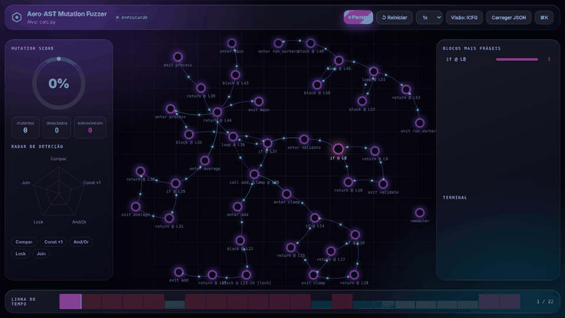
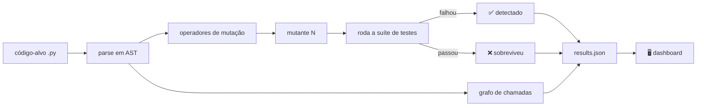

<div align="center">

# 🧬 Aero·AST Mutation Fuzzer

**Mutation testing por AST para auditar código gerado por LLMs, com um centro de comando visual em tempo real.**

[](https://github.com/kallymeire/Aero-AST-Mutation-Fuzzer/actions)


[**▶ Ver o dashboard ao vivo**](https://kallymeire.github.io/Aero-AST-Mutation-Fuzzer/) · [Como funciona](#-como-funciona) · [Começar](#-começar-em-1-minuto) · [Roadmap](#-roadmap)



</div>

---

## 💡 Por que isto existe

Código gerado por LLM costuma vir com testes que **passam**. Mas testes passando não significam testes bons.

O Aero injeta pequenas falhas lógicas no código (inverter uma comparação, remover um `lock`, errar uma constante por 1) e roda a sua suíte de testes em cada versão alterada:

- Se algum teste **falha**, o mutante foi **detectado** ✅
- Se todos **passam**, o mutante **sobreviveu** ❌ e aponta uma lacuna real nos testes

O resultado é um **mutation score** e um mapa de onde o código está desprotegido.

## 🖥️ O dashboard

Um centro de comando em HTML puro (sem build, sem dependências) que lê o `results.json` do fuzzer.

| | |
|---|---|
| **Grafo ao vivo** | Cada função é um nó com anel verde/vermelho (detectado/sobreviveu). Os mutantes caem como faíscas e explodem no bloco atingido. |
| **Visão ICFG** | Alterne para o grafo de fluxo de controle: blocos, ramos `if`, laços (setas tracejadas) e chamadas entre funções. Cada mutante cai no bloco de código onde está. |
| **Viagem no tempo** | Arraste a linha do tempo para voltar e avançar na execução. |
| **Inspetor** | Clique em um bloco para ver os mutantes que sobreviveram, com o diff real do código. |
| **Radar por operador** | Taxa de detecção de cada tipo de mutação. Clique para filtrar o grafo. |
| **Paleta de comandos** | `Ctrl/⌘ + K` para rodar, filtrar operadores ou saltar para um bloco. |

Tema claro e escuro automáticos, funciona no celular.

## ⚙️ Como funciona



### Operadores de mutação

| Operador | O que faz | Exemplo |
|---|---|---|
| `CMP_FLIP` | Inverte a fronteira de uma comparação | `x < lo` → `x <= lo` |
| `CONST_OFF_BY_ONE` | Soma 1 a uma constante inteira | `limit = 100` → `101` |
| `BOOL_SWAP` | Troca `and` por `or` (e vice-versa) | `a and b` → `a or b` |
| `LOCK_REMOVE` | Remove a seção crítica protegida por lock | `with lock:` → *(sem lock)* |
| `JOIN_REMOVE` | Remove o `join()` de uma thread | `t.join()` → *(removido)* |

`LOCK_REMOVE` e `JOIN_REMOVE` são o ponto de partida para auditar **concorrência**: se remover o lock ou o `join()` não quebra nenhum teste, nenhum teste exercita acesso concorrente. Esses sobreviventes aparecem marcados com ⚠️ no relatório.

## 🚀 Começar em 1 minuto

```bash
git clone https://github.com/kallymeire/Aero-AST-Mutation-Fuzzer.git
cd Aero-AST-Mutation-Fuzzer
pip install -r requirements.txt

python aero/fuzzer.py examples/demo calc.py "python -m pytest -q"
```

Saída esperada:

```
22 mutantes | 14 sobreviveram | score 36.4% | 8 workers | 0.4s
```

Depois abra `docs/index.html` no navegador, clique em **Carregar JSON** e escolha o `results.json` gerado.

Uso com o seu projeto:

```bash
python aero/fuzzer.py <pasta_do_projeto> <arquivo_alvo.py> "<comando de teste>" \
       -j 8 --report report.md
```

| Opção | O que faz |
|---|---|
| `-j N` | Roda N mutantes em paralelo (padrão: número de CPUs) |
| `-o arquivo.json` | Caminho do resultado (padrão: `results.json`) |
| `--report arquivo.md` | Gera relatório em Markdown com ranking de risco e diffs |

No GitHub Actions, o relatório também aparece no resumo de cada execução.

### Formato do `results.json`

```json
{
  "target": "calc.py",
  "edges": [["main", "process"], ["process", "add"]],
  "icfg": {"nodes": ["..."], "edges": ["..."]},
  "risk": [{"fn": "validate", "total": 5, "survived": 4, "rate": 0.8}],
  "mutants": [
    {"id": 1, "op": "CMP_FLIP", "line": 8, "fn": "validate", "node": "N2",
     "before": "if v < 0 or v > limit:", "after": "if v <= 0 or v > limit:",
     "status": "survived", "ms": 14}
  ]
}
```

## 🗂️ Estrutura

```
Aero-AST-Mutation-Fuzzer/
├── aero/
│   ├── fuzzer.py            # motor de mutação, ranking e relatório
│   ├── icfg.py              # ICFG simplificado (blocos, ramos, laços, chamadas)
│   └── ...                  # módulos experimentais (gramática, concorrência, LLVM, pipeline)
├── docs/                    # dashboard (publicado via GitHub Pages)
│   ├── index.html
│   ├── sample-results.json
│   └── demo.gif · dashboard.png
├── examples/demo/           # código e testes de exemplo
├── tests/                   # testes do próprio fuzzer
└── .github/workflows/ci.yml # CI: testa o fuzzer e roda a análise
```

## 🧭 Roadmap

- [x] Motor de mutação por AST com 5 operadores (comparação, constante, booleano, lock, join)
- [x] Grafo de chamadas entre funções e registro do diff real
- [x] Dashboard interativo com viagem no tempo
- [x] ICFG simplificado (blocos, ramos, laços e chamadas entre funções) com visão própria no dashboard
- [ ] ICFG completo (arestas de retorno, exceções, chamadas indiretas)
- [ ] Suporte a C/C++ via LLVM IR (`clang -emit-llvm` + `llvmlite`)
- [x] Operadores básicos de concorrência (`LOCK_REMOVE`, `JOIN_REMOVE`)
- [ ] Mais operadores de concorrência e memória (ordem de locks, `free` antecipado)
- [ ] Geração de mutantes guiada por gramática
- [x] Ranking de risco por função e relatório em Markdown
- [ ] Comentário automático no Pull Request com o relatório
- [x] Execução paralela dos mutantes (`-j`)

## ⚠️ Limitações

- Hoje o alvo é código **Python**. O suporte a C++ e LLVM está no roadmap.
- O ICFG é **simplificado**: não modela exceções, chamadas indiretas nem arestas de retorno. A visão padrão do dashboard é o grafo de chamadas entre funções.
- **Mutantes equivalentes** (que não mudam o comportamento, como `x > hi` → `x >= hi` em alguns casos) aparecem como sobreviventes. Revise cada um antes de concluir que falta teste.
- É uma ferramenta de **auditoria de testes**, não de descoberta de vulnerabilidades reais.

## 👩‍💻 Autora

**Kallymeire Coelho** · [GitHub](https://github.com/kallymeire)

## 📄 Licença

MIT. Veja [LICENSE](LICENSE).
